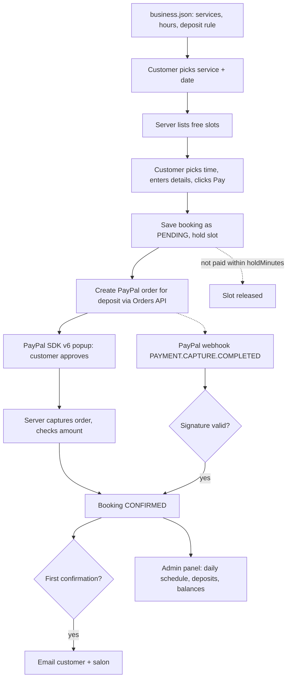

# deposit-booking

A white-label booking page for salons and other service businesses. Customers pay a deposit with PayPal (JS SDK v6 + Orders API), and a webhook confirms the booking automatically. Inspired by https://www.instagram.com/reel/DfnuOFrPiwa/

## Quick start

```bash
npm install
npm run demo                     # full flow in the terminal, PayPal simulated
npm start -- --demo              # open http://localhost:3000 (admin: /admin, password "admin")
cp .env.example .env             # then add your PayPal sandbox keys
npm start                        # real PayPal sandbox checkout
```

Requires Node 20.12+. `npm test` runs the tests.

## How it works

1. **The business is one file.** `business.json` holds the name, brand color, services (price and length), opening hours and deposit rule. To re-skin the app for another client, swap this file.
2. **Customer picks a service and a day.** The server lists start times inside opening hours where the whole appointment fits. It skips times that have passed and times that overlap another booking.
3. **The deposit is calculated.** It is `depositPercent` of the price, never less than `minDepositCents` and never more than the full price.
4. **Customer clicks Pay.** The server saves the booking as **pending**, which holds the slot for `holdMinutes`. It then creates a PayPal order for the deposit using the Orders API, with the booking ID attached as `custom_id`.
5. **PayPal popup.** The PayPal JS SDK v6 opens checkout on the page and shows whichever payment methods the device supports. The customer never leaves the site.
6. **Capture.** When the customer approves, the server captures the order straight away and checks that the captured amount equals the deposit. The booking becomes **confirmed**.
7. **Webhook safety net.** PayPal also sends `PAYMENT.CAPTURE.COMPLETED` to `/api/paypal/webhook`. The server verifies the signature with PayPal and confirms the booking if it isn't confirmed yet, which covers a customer closing the tab mid-payment. Confirming twice does nothing.
8. **Emails.** The first time a booking is confirmed, one email goes to the customer and one to the salon. They are sent over SMTP if `SMTP_URL` is set; otherwise they are saved as `.eml` files in `outbox/`.
9. **Admin panel.** `/admin` is password protected. It shows the day's schedule, confirmed and pending counts, deposits collected, the balance still due in store, and every booking with its PayPal ID.
10. **Unpaid holds expire.** A pending booking that is older than `holdMinutes` stops blocking its slot, so abandoned checkouts free up the time.



## Configuration

| Env var | What it is | Where to get it |
|---|---|---|
| `DEMO` | `true` simulates PayPal. Demo mode is also used when `PAYPAL_CLIENT_ID` is empty or `--demo` is passed | Your choice |
| `PAYPAL_CLIENT_ID` | REST app client ID | [developer.paypal.com](https://developer.paypal.com) → Apps & Credentials |
| `PAYPAL_CLIENT_SECRET` | REST app secret | Same page as the client ID |
| `PAYPAL_WEBHOOK_ID` | ID of the webhook subscribed to `PAYMENT.CAPTURE.COMPLETED`, pointing at `https://<your-host>/api/paypal/webhook` | Your app → Webhooks. For local testing, expose the port with a tunnel such as `ngrok http 3000` |
| `PAYPAL_ENV` | `sandbox` (default) or `live` | Your choice |
| `PORT` | HTTP port (default 3000) | Your choice |
| `BASE_URL` | Public URL, printed at startup | Your host |
| `ADMIN_PASSWORD` | Password for `/admin` (any username; default `admin`) | Choose a strong one |
| `SMTP_URL` | SMTP connection string for real emails. Empty means emails are written to `outbox/` | Your email provider (Gmail app password, Postmark, SES, …) |
| `MAIL_FROM` | Sender address for confirmation emails | Your domain |
| `BUSINESS_FILE` | White-label business config (default `business.json`) | Copy and edit `business.json` |
| `DATA_DIR` | Folder for `bookings.json` (default `data`) | Your choice |
